  

  

<pre>
ZAAC(1)                        Developer Manual                        ZAAC(1)

NAME
       zaac — full-stack developer. not a vibecoder.

PROJECTS
       meeti          paid 1:1 video calls for creators    next · expo · socket.io
       <a href="https://cardevo.net">cardevo</a>        ai business cards for freelancers    next · mongo · gemini
       <a href="https://apexindexer.com">apexindexer</a>    bulk google indexing api, saas       next · postgres · bullmq

SEE ALSO
       <a href="https://linkedin.com/in/rai-zaroon-raza-85430b312">linkedin(1)</a>, <a href="https://instagram.com/Rai_Zaroon_Raza">instagram(1)</a>, <a href="mailto:razaraizaroon@gmail.com">mail(1)</a>
</pre>

<pre>
$ git log --graph --author=ZaaC360
</pre>

  

<code>EOF</code>

