  

  

<pre>
ZAAC(1)                        Developer Manual                        ZAAC(1)

NAME
       zaac — full-stack developer. not a vibecoder.

SYNOPSIS
       zaac [--build] [--ship] [--debug <i>until-it-works</i>]

DESCRIPTION
       Builds products end to end: interface, api, database, deploy.
       Prefers understanding a thing over importing it, so rewrites
       Promise.all and debounce just to see how they tick.

PROJECTS
       <a href="https://github.com/ZaaC360/headlessShopify">headlessShopify</a>         headless storefront, typescript
       <a href="https://github.com/ZaaC360/Neon-Rubik-s-Cube">neon-rubiks-cube</a>        glowing interactive cube, vanilla js
       <a href="https://github.com/ZaaC360/freelancing-platfrorm">freelancing-platform</a>    client ↔ freelancer marketplace, python
       <a href="https://github.com/ZaaC360/Promise.all-polyfill">promise.all-polyfill</a>    js internals, from scratch
       <a href="https://github.com/ZaaC360/Debounce">debounce</a>                same, different primitive

BUGS
       Occasionally refactors code that already works.

SEE ALSO
       <a href="https://linkedin.com/in/rai-zaroon-raza-85430b312">linkedin(1)</a>, <a href="https://instagram.com/Rai_Zaroon_Raza">instagram(1)</a>, <a href="mailto:razaraizaroon@gmail.com">mail(1)</a>

ZaaC360                            2026-10                            ZAAC(1)
</pre>

<pre>
$ git log --graph --author=ZaaC360
</pre>

  

<code>EOF</code>

